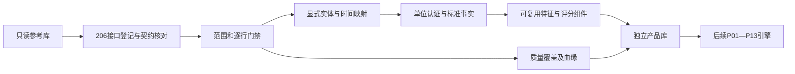

# 产品加工基础层

`product_foundation` 实现 13 个研究产品共用的模型、门禁、统计组件和独立产品库。本阶段没有实现 P01—P13 业务引擎，也不产生股票候选、ETF 排序、历史策略收益或自动交易指令。

## 数据经过门禁才进入特征

输入是已有 `reference.duckdb`，始终以只读连接打开。输出是独立的 `products.duckdb`，不修改正式原始层、参考层、旧 `products.py` 或旧产品命令。相同路径、符号链接和硬链接指向同一文件时拒绝执行。



初始化只发布共享基础事实。`feature_value`、`signal_fact`、`score_component` 留给显式调用公共组件的后续引擎；初始化不会虚构业务特征或空产品已完成的状态。

| 质量状态 | 基础层处理 |
| --- | --- |
| `verified` | 继续检查实体、时间、单位和字段契约，通过后才允许计算 |
| `usable_with_annotation` | 保留注释，当前通用数值适配默认降级为 `annotation_not_adapted`，不擅自解释业务变体 |
| `quarantine` | 只统计隔离数量，不读取隔离行用于默认特征 |
| 缺表、缺字段、旧观测、缺单位或实体 | 保存明确原因和可空数值；缺接口行数为未知，不补成零 |
| 范围或业务新鲜度未检查 | 保留 `universe_coverage_not_checked`、`business_freshness_not_checked`，不声称全市场或最新数据完整 |

无成交参考收盘不能用于收益、波动率、价格排序、溢折价或成交可行性。`repo_daily.close` 是利率，结算价不当作成交价格。金额运算需要字段单位证书和币种；不同币种的金额直接拒绝，汇率适配留给后续提供完整方向、时点和证据的组件。

## 包内职责

| 模块 | 本阶段能力 |
| --- | --- |
| `model`、`contracts` | 严格 JSON 往返、身份及原因码校验、非有限数拒绝、`DecisionEnvelope/v1`、质量和置信度分量 |
| `entities`、`bindings` | 实体类型与生命周期、有效区间、精确别名解析、带证据关系、显式接口字段绑定 |
| `temporal` | 观察、公开、业务期间和生效区间；观察后可用性判断 |
| `numeric` | 字段单位证书、标准单位优先、四则运算与价格门禁 |
| `features`、`config` | 原值特征适配、平均秩百分位、缺失门槛、贡献、分档排名和权重敏感性 |
| `signals` | 事件阶段、三值谓词、支持与反证、失效条件和复核时间 |
| `registry` | 附件矩阵的确定性加载及 206 接口精确校验 |
| `storage_records`、`storage` | 11 张共享表、事务、幂等、不可变记录、自动血缘及完整性校验 |
| `reference_scan`、`reference`、`cli` | 只读参考库适配、逐接口覆盖、离线初始化和校验 |

`standard` 的时间和期间规范化、`pit.time_boundary`、`reference_contract`、`reference_storage.file_checksum` 和 `store.encode/digest` 继续复用。没有复制旧产品编排，也没有扩大旧 `products.py`。

## 身份和时间不能互相替代

实体身份格式为 `namespace:kind:local_id:lifecycle_id`。证券、公司、ETF 份额、指数、期货品种、期货合约和期权合约是不同类型。别名、关系记录有效区间、观察版本、来源、证据和 0—100 置信度。别名多解直接拒绝；同名不代表同实体。

`business_group_key`、`business_variant_key` 和 `source_record_id` 全部保留在来源证据中，组键只在 `source_api` 内解释。来源业务字段必须经 `EntityMapping` 和有效别名才能连接统一实体；不会用不同接口的业务哈希相等建立关系。BSE 新旧代码可以通过显式别名指向同一生命周期实体，海外代码复用应登记为不同生命周期。

| 时间字段 | 含义 |
| --- | --- |
| `analysis_as_of` | 研究可使用信息的截止时刻，必须带时区 |
| `data_as_of` | 行情日、数据期间或事件业务日期，保留原频率 |
| `observed_at` | 实际观察时刻，不以报告期倒填 |
| `public_available_at` | 已核定的公开可用时刻，缺失时只能做观察后研究 |
| `effective_from/to` | 生效区间，左闭右开，与是否已经公开分开判断 |
| `report_period` | 报告期间，不证明公开或生效时间 |

日期级公告按显式来源市场时区取次日零点；精确时间戳必须带时区。观察后可用时点取观察和已知公开边界的较晚值。已经公开的未来计划可以进入事件事实；需要判断已实施状态时，还须通过生效区间门禁。

本阶段 `historical_pit_certified=false`。历史模式关闭，`historical_tradable=true` 拒绝发布；`decision_allowed` 只表示可进入人工研究流程。独立的历史版本认证和历史可交易重建尚未实现。旧 `pit.as_of` 的 UTC 日期边界行为保持原样，新产品层使用自己的市场时区映射。

## 评分规则由版本配置传入

`FoundationPolicy` 集中定义初始阈值，所有统计调用显式接收配置；以下数值是设计初值，没有经过真实数据校准。

| 参数 | 默认值 | 用途 |
| --- | ---: | --- |
| `minimum_peer_count` | 30 | 同组及上级回退后的最小合格样本数 |
| `minimum_weight_coverage` | 0.8 | 非核心特征允许缺失的权重门槛 |
| `contribution_tolerance` | 1e-8 | 非空分数与贡献和的最大误差 |
| `weight_perturbation` | 0.1 | 逐个权重正负 10% 后重新归一与评分 |
| `minimum_top_k_jaccard` | 0.7 | 标记对权重敏感的集合相似度阈值 |
| `top_k` | 10 | 稳定性分析的研究容量 |
| `maximum_observation_age_days` | 7 | 最近采集观察的最大年龄，不表示财务报告期仅有 7 天有效期 |

百分位为 `(平均秩-1)/(n-1)`，同值取平均秩、全同值为 0.5；低值优先时反转。只统计同截止、同范围和同特征档的合格非空记录。`peer_path` 从市场到下级行业排列，不足时逐层向上回退，最上层仍不足则返回空分位。

评分使用 `100 × Σ(可用权重 × 归一特征) / Σ可用权重`。核心项缺失时不发布分数；非核心项按可用权重门槛判断。实际权重配置、真实可用特征集合、各特征版本、窗口、单位和变换共同构成 `feature_profile`，不同档位不混排。评分的 0—100 数值不代表上涨概率；硬门禁独立保存，无法由高分抵消。

稳定性分析对每个权重分别做两个方向的扰动，输出各场景 Top-K Jaccard 及基线、扰动下的排名区间。平均名次处于 Top-K 的同值对象一起入集；不够样本时不报告虚假稳定性。

## 独立产品表与 SQL

数据库中的共享表都位于 `product` schema。各表有稳定 `record_id`、严格模型的 `payload` JSON，以及常用字段的有类型 SQL 投影。

| 共享表 | 记录内容 |
| --- | --- |
| `entity` | 统一实体身份和名称 |
| `entity_alias` | 来源别名及有效区间 |
| `entity_relation` | 实体两端、关系类型和确认状态 |
| `availability_fact` | 来源记录的公开、观察和生效证据 |
| `typed_fact` | 单位认证后的数值或带原因的空值 |
| `feature_value` | 特征、口径、窗口、分母和版本 |
| `signal_fact` | 规则、三值结果及下次复核时间 |
| `score_component` | 结果对应的逐特征贡献 |
| `quality_gate_result` | 结果和规则版本对应的门禁 |
| `coverage_slice` | 每接口、请求范围、分区及批次的质量账本 |
| `lineage_edge` | 输出到来源接口、记录及字段的使用或排除边 |

```sql
-- 查看缺失及未启用原因，不将 NULL 行数当作 0。
SELECT source_api, accepted_rows, quarantined_rows,
       json_extract(payload, '$.reason_codes') AS reason_codes
FROM product.coverage_slice
ORDER BY source_api;

-- 查看已认证金额；entity_id 和 data_as_of 等细节仍在 payload 中。
SELECT entity_id, source_api, field, value, unit,
       json_extract_string(payload, '$.currency') AS currency
FROM product.typed_fact
WHERE value IS NOT NULL AND quality_tier = 'verified';

-- 查询某个已存结果的字段证据。
SELECT output_id, source_api, source_record_id, relationship,
       json_extract(payload, '$.fields') AS used_fields
FROM product.lineage_edge
ORDER BY output_id, source_api, source_record_id;
```

`ProductStore.put` 只接受表对应的模型。相同键和内容重复写入不增加记录；相同键内容不同则报冲突，调用方必须给新版本。上下文内失败会回滚。校验不仅重读 JSON，还核对 SQL 投影、实体引用和自动血缘，篡改投影或删除血缘都会失败。

## 离线运行

```bash
uv run tushare-hub product-foundation initialize \
  --reference data/reference.duckdb \
  --output data/products.duckdb \
  --as-of 2026-10-02T00:00:00Z

uv run tushare-hub product-foundation validate \
  --reference data/reference.duckdb \
  --output data/products.duckdb
```

上述截止时间仅是示例，实际调用应明确选定研究时点。初始化可通过 `--config` 读取 `FoundationPolicy` JSON，通过 `--bindings` 读取 `FoundationBindings` JSON；模型均支持 `to_json/from_json`。

绑定文件分别登记 `entities`、`aliases`、`entity_mappings`、`time_mappings` 和 `certifications`，不能用一个猜测规则覆盖所有接口。`expected_data_as_of` 指定逐来源预期业务期间；未提供时业务新鲜度保持未检查。没有绑定文件时仍能初始化表和 206 项覆盖账本，但不会猜测实体或认证单位。

`UnitCertification` 明确来源接口、字段、原单位、目标单位、量纲、币种、倍数、版本及证据。适配先检查参考行的 `standard_units`：已是目标单位则保持数值，仍是原单位才按证书换算。万份与份、基金手数与股票股数等必须分别认证，不套用股票每手股数。

| 命令结果 | 退出码 | 含义 |
| --- | ---: | --- |
| 初始化降级 | 2 | 已生成可查询基础库，JSON 中逐项披露缺口；本阶段范围认证尚未启用，因此初始化状态为 `incomplete` |
| 初始化失败 | 1 | 路径、契约、数据结构或存储失败，输出固定原因码，不输出原始异常及敏感载荷 |
| 校验 `valid=true` | 0 | 注册表、输入指纹和产品存储一致；原有 `incomplete` 状态仍保留 |
| 校验 `valid=false` | 1 | 输入发生变化或产品模型、投影、血缘等不一致 |

CLI 不读取凭据、不发网络请求。输入文件指纹、规则、绑定和截止时点共同决定批次身份；重复运行先校验已存事实，不能复用损坏产物。每批配置和摘要单独保存；补充时间映射后，保留旧时间事实并发布新版本。DuckDB 固定单线程、512MB 内存；参考读取采用分批游标。尚未测量 206 接口真实数据量下的性能。

## 206 接口登记与后续接入

`data/product_consumers.csv` 是用户附件《接口产品覆盖矩阵》的原样确定性副本，保留类别、API、主产品、角色、用途、业务键、选用字段、声明单位和来源文档。打包文件固定摘要，加载时防止静默篡改；初始化和校验都要求恰好 206 个唯一接口，并与当前政策、字段、主键例外和来源文档逐项一致。`pro_bar` 使用运行时 `daily` 组合字段契约，不算独立行情证据。

新引擎应先登记自己的业务输入契约和版本，然后消费已可见的 `TypedFact`，通过 `feature_from_fact` 构建默认特征，再调用分位、评分、门禁和信号组件。非空分数携带贡献和证据，结果使用 `DecisionEnvelope/v1`；支持、反证、进入条件、失效条件和复核时间分别保存。

未来 P01—P13 分别实现其业务 DAG，不能直接把登记中的主产品名称解释为引擎已完成。财务 TTM、股票动量、ETF 穿透、资金拥挤、组合风险及事件收益归因都尚未实现。共享事件模型先保留来源阶段和时间；事件归并、人审映射、历史认证、调度和部署也不由本阶段自动执行。

本阶段验证全部使用离线合成数据。真实参考库的字段非空率、单位证据、映射覆盖、市场范围、历史窗口和投资研究效果仍需另行验证。
