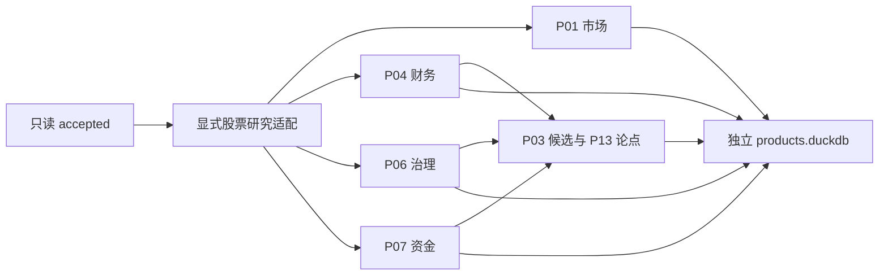

# 股票研究闭环

本阶段实现 P01、P03、P04、P06、P07、P13。入口从只读参考库加工数据，结果写入独立产品库。当前模式为 `observed_research`，所有结果都保留 `historical_pit_certified=false`，不生成历史回测、收益预测或自动交易指令。

## 引擎与共享适配分开

`equity_research` 包内，`adapter.py` 检查参考契约、实体、时点和单位，`models.py` 定义输入与结果，`common.py` 复用证据去重、同行分位和公共信封。六个引擎分别放在 `market.py`、`fundamental.py`、`governance.py`、`flow.py`、`candidates.py`、`events.py`。`pipeline.py` 展开依赖并控制事务，CLI 只处理参数、进度和退出码。



原有 `product_foundation` 和 206 接口消费登记保持兼容。新的 `research` schema 保存业务结果，原有 `product` schema 仍供基础层使用。六产品分配的 99 个唯一接口全部绑定到实际执行器：`consumption_registry.py` 校验分配与处理器一致，适配器据此扫描，`consumption.py` 保存逐接口结果并核对引用。`context_consumers.py`、`disclosure_consumers.py` 和 `flow_consumers.py` 分别处理市场与技术旁证、财务治理证据、局部资金与资格背景。

| 产品 | 分配接口数 | 本轮补齐的消费 |
| --- | ---: | --- |
| P01 | 19 | 指数身份与当前状态、指数周月核对、市场汇总对账、LPR、经济日程、账户、市场资金、交易日历 |
| P03 | 16 | 北交所代码映射、复权锚点、日周月与组合行情核对、因子字典、供应商技术旁证 |
| P04 | 10 | 备用估值股本快照、普通与 VIP 财务指标同口径核对 |
| P06 | 25 | 新股、治理事件、持有人、转债行情与发行、评级、票息区间证据 |
| P07 | 24 | 筹码成本核对、游资字典与局部席位、陆股通前十、连板、融资资格、转融券及龙虎榜背景 |
| P13 | 5 | 延续新闻、宏观与披露日程、指数公告、名称变更，并接收上游产品证据 |

99/99 表示每个分配接口都有会被执行的真实消费路径；当前数据是否可用另按接口状态披露。缺绑定时对应来源不会扫描，结果保留 `unknown`，不能把执行过降级逻辑称为读到了数据。

## 六个产品的计算边界

| 产品 | 已实现加工 | 拒绝或降级条件 |
| --- | --- | --- |
| P01 `market_context/v1` | 同交易日有效股票广度、合格分母、无成交及停牌等排除数、前 10% 股票成交集中度、跌停占比、三项等权压力分。连接停复牌记录。PMI、PPI、M1/M2 差、社融、CPI 和季度 GDP 保留报告期与可用时间，检查相邻期后才给变化 | 无有效成交价不计广度；跌停边界不齐时不发布压力分；宏观缺相邻期只给当前值，不把月值当每日新信息 |
| P04 `fundamental_dossier/v1` | 按实体、报告期、报表类型、公司类型选择已可见版本。计算 `cash_margin`、`leverage`、`cash_cover`、`balance_error` 和 `quality_score`／`Q0`。核查审计，保留负权益、负利润证据 | 三表口径、单位、版本、行业或审计不合格时不发布合格质量评分；VIP 与普通接口一致时只计一份经济证据；同可用时点冲突不任选版本 |
| P06 `capital_governance_risks/v1` | 公告、计划、实施、终止分开；认证后计算未来 30 自然日解禁、计划和实施定增稀释、CB 全部转股上界、质押与供给压力。ST、重点监控和重大状态冲突独立门禁 | 未确认批次不相加；未知与无适用事件分开；缺少 CB 身份、正股关系、期间、币种或单位时不算稀释；EB 不按 CB 处理 |
| P07 `flow_feasibility/v1` | 各资金来源独立除以同日合格成交额，计算中位数、方向、一致性、资金支持；融资强度、换手和合格筹码分布形成独立拥挤轴。保留大宗折价证据 | 停牌、无价格、涨跌停、严重异动、量额矛盾、过期分别检查；少于两个可比资金来源时一致性未知；匿名席位和局部分钟数据不外推 |
| P03 `equity_research_candidates/v1` | 消费 P04/P06/P07，计算价值 V0、流动性 L0、完整 C0 或市场档分数，隔离财务类型、profile 与同行回退层后排名。输出贡献、反证、排除理由、下一问题和删一因子排名区间 | 负 PE、负 PB 或认证负权益／亏损进入问题研究档；分数不能抵消硬门禁；样本不够不排名；缺财务只能进独立市场档 |
| P13 `event_thesis_review/v1` | 整理新闻、披露日程、宏观日程、指数公告、名称变更和上游结果。保存原文片段、实体候选、人工关系、三值论点与确定性复核顺序 | `documented_reason` 必须引用原文原因句；`temporal_association` 只表示已核对的同窗观察。无代码文本和歧义实体等待确认；持仓权重未知不补造；历史不足不算 CAR |

同行分位使用平均秩，默认至少 30 个同口径合格样本；相同值取 0.5。`peer_paths` 从大类到细类给出认证后的同行路径，允许逐级回退。不同财务口径与实际回退层不会混排。

核心公式保持设计原义：`Q0=100×[0.4p(cash_margin)+0.35(1-p(leverage))+0.25p(cash_cover)]`，`V0=mean[p(1/pe_ttm),p(1/pb)]`，`L0=p(log(1+amount_cny))`，`C0=0.45Q0+35V0+20L0`。市场档为 `100×(0.6V0+0.4L0)`。公式档另存于 `details.score_profile`，`feature_profile` 追加公司类型等可比边界。

## 显式绑定决定可计算范围

`--config` 接受 `ResearchConfig` 的 JSON 序列化结果。`foundation` 内沿用 `FoundationBindings` 的实体、别名、时间映射和单位证书；不会从代码形状或中文名称推断实体与币种。无绑定时先审计接口就绪条件，不逐行扫描。

行内实际存在的 `ann_date`、`f_ann_date`、`pub_date` 必须纳入公开时间映射。日期级公开时间采用显式市场时区的次日零点，无法认证时拒绝该行。日频行情和财务业务日期不能晚于研究截止日；已公告的未来事件另按计划阶段处理。

| 配置项 | 含义 |
| --- | --- |
| `version` | 固定 `equity-research/v1`，规则改变必须升级版本 |
| `foundation` | 已认证实体、有效期别名、字段时间、单位、预期业务日期 |
| `thresholds` | 基础层版本化阈值，默认同行样本 30、批大小 512、观察年龄上限 7 日 |
| `peer_paths` | 每个股票实体的可比组路径；没有认证路径时不生成分位 |
| `certified_report_types` | 允许计算的已认证报表类型；空列表不擅自认定合并范围 |
| `complete_scopes` | 明确已完整核查的 API 请求范围；缺表、契约失败、局部容量拒绝仍优先保留未知 |
| `confirmed_relations` | 带证据与有效期的人工关系；CB 使用 `cb_underlying`，事件实体使用 `event_entity` |
| `maximum_rows_per_entity_source` | 每来源每实体最多保留 512 行，跨报表口径累计；溢出整实体来源拒绝 |
| `maximum_source_rows`／`maximum_total_rows` | 默认 32768／131072 行，限制观察集内存；溢出来源不参与精确总量和评分 |

人民币金额使用认证后的“元”，股票数量使用“股”，比例按字段契约使用 `ratio` 或 `fraction`。`fraction` 指标限定在 0 到 1，解禁、稀释等可能超过 1 的比值使用 `ratio` 保留原值。已由参考层换算的金额不再乘一次单位因子。价格证书区分当日成交价与转股价、涨跌停边界、筹码报价，后者不会被当成真实成交。

参考库实际读取缓冲最多 128 行，调用方批大小限定在 1 到 512。研究存储和来源回查的直接入口也使用这一硬上限，非法批大小在访问数据库或消费生成器之前拒绝。写入另按编码后 JSON 的 512KiB 预算和最多 128 行拆批，单条超预算记录独占一批、不截断；较大的 `result` 载荷逐条写入。参数列替代整批 JSON 的反复展开，写入连接关闭插入顺序保留，确定性由主键和规范排序保证。

普通日频保留当前业务日，财务按口径保留当前报告期，宏观保留最近两个报告期；评级按机构、周月按频率、因子按名称分别保留，事件受容量门禁限制。DuckDB 使用 1 个线程和 512MB 内存限额。扫描账本区分 `retained_rows`、`excluded_rows`、`discarded_rows`，三者之和等于 `scanned_rows`；历史释放和容量拒绝归入 `discarded_rows`。

## 命令行与幂等运行

以下命令均离线运行。`initialize` 与 `run` 走同一条原子路径，第一次创建产品表，之后按输入指纹决定复用或写入新批次。

```bash
uv run tushare-hub research initialize \
  --reference /path/to/reference.duckdb \
  --output /path/to/products.duckdb \
  --as-of 2026-10-03T12:00:00Z \
  --config /path/to/research-config.json

uv run tushare-hub research run \
  --reference /path/to/reference.duckdb \
  --output /path/to/products.duckdb \
  --as-of 2026-10-03T12:00:00Z \
  --config /path/to/research-config.json \
  --product P03 --product P13

uv run tushare-hub research validate \
  --reference /path/to/reference.duckdb \
  --output /path/to/products.duckdb
```

选择 P03 或 P13 时自动运行 P04/P06/P07 依赖。进度逐行输出到 stderr，stdout 只输出一个 JSON 摘要。运行成功且全部可用退出 0，存在诚实降级退出 2，参数或执行失败退出 1；校验成功退出 0、失败退出 1。

运行键绑定参考文件 SHA256、截止时点、完整配置、请求产品集合和规则版本，并加入 `equity-consumption/v2` 及消费注册指纹。旧 48 接口运行键不会被当作新 99 接口运行复用。相同输入重跑先验证已有结果，再返回相同摘要，不增加记录。不同运行保留各自结果，`research.metadata.current_run` 指向当前批次。信封 `generated_at` 使用确定性的逻辑生成时点，即 `analysis_as_of`；该字段不能作为历史运行发生时间或历史 PIT 认证的证据。

旧 48 接口产物缺少新消费账本，不能通过本版本的 99 接口完整性校验。升级验收应从只读参考库输出到新的产品库路径，并保留旧库；不会自动为旧结果补造消费证据。

## 输出表与完整校验

每张数据表都有 `record_id` 主键、`run_id`、`result_id` 和 JSON `payload`，便于独立 SQL 查询。输出采用有限数值，缺失保留空值与原因码。

| 表 | 保存内容 |
| --- | --- |
| `research.result` | 公共 DecisionEnvelope、业务指标、扩展解释、上游结果键和三值论点 |
| `research.feature` | 原值、单位、available／unknown／not_applicable、原因和证据 |
| `research.contribution` | 每项权重、归一值、分组与评分贡献 |
| `research.evidence` | 来源接口、记录／业务组／变体身份、契约摘要、字段定位及观察时间 |
| `research.gate` | true／false／unknown 门禁、硬门禁标志和原因 |
| `research.signal` | 论点谓词的确定性三值结果 |
| `research.lineage` | used／contrary 来源关系和 parent 产品依赖 |
| `research.run` | 输入指纹、配置、规则版本、产品依赖闭包与运行摘要 |
| `research.metadata` | 当前批次定位 |

```sql
SELECT payload->'envelope'->>'product_id' AS product,
       payload->'envelope'->>'entity_id' AS entity,
       payload->'envelope'->>'state' AS state,
       payload->'envelope'->>'score' AS score
FROM research.result;

SELECT payload->>'name' AS feature,
       payload->>'value' AS value,
       payload->>'status' AS status
FROM research.feature;
```

校验会重建模型和全部派生表，对账主键、结果与父引用、数值范围、三值状态、贡献、产品依赖、运行摘要和规则指纹。当前批次的证据还会回查只读 `accepted` 行；配置中明确提供的别名、单位和人工关系证据则与配置逐字核对。历史批次保留原参考指纹并检查内部完整性，当前参考文件不冒充旧批次原始文件。

每条结果的 `details.consumption` 按所属产品保存精确接口清单，包含矩阵角色与用途、处理器、保留策略、已读行数、字段质量、业务事实、证据和三值门禁。消费引用进入 `research.evidence` 与 `research.lineage`，门禁进入 `research.gate`；新增旁证不改变原核心分值或贡献。未关联转债和全局字典由独立 `source_observation` 结果承接，不能混入股票排名。

运行摘要的 `consumption` 分别统计 `assigned_apis`、`registered_apis`、`executed_apis`、`observed_apis`，并用 `by_api` 保存状态分解。`observed` 表示有合格行和引用的当前观察；`conflict` 表示同口径核对发现分歧；`unknown` 表示缺字段、单位、关系或绑定；`not_applicable` 表示确认不适用；`not_enabled_due_to_history` 表示已经读到数据并保存引用，但相应历史计算条件不足。完整校验会重验这些记录，拒绝用空行、无引用或 `1/0` 冒充有效状态。

## 降级后的结果仍能追查

`annotated` 表示可供当前观察研究，但历史 PIT 未认证。`incomplete` 表示必需数据、口径或门禁未知；`blocked` 表示硬门禁明确失败。`unknown` 不等于 `false`，也不等于无风险。只有已核查完整范围且确无相关事件时，指标才可标为 `not_applicable`；不适用也不会作为数值 0 混入供给评分。

所有产品只读取 `accepted`。`fut_daily`、`fut_weekly_monthly`、`idx_factor_pro`、`opt_daily` 的隔离数据不会进入本阶段股票评分。日线 0 价或无成交占位也不能用于收益、广度或可行性。未来观察和未来公开信息会在适配时拒绝，已公告的未来事件只作为计划保留。

## 与设计附件的适配差异

金额与比例认证仍以仓库当前契约为准。财务总权益使用真实字段 `total_hldr_eqy_inc_min_int`，不会拿归母权益补齐平衡式；`report_type`、版本和三表金额没有默认认证。东方财富和同花顺资金都使用真实 `net_amount`，分别归一，未把不同来源金额相加。季度 GDP 使用 `quarter` 和 `gdp_yoy`，CPI 使用 `month` 和 `nt_yoy`。

产品结果以每证券当前观察记录为主，P06 的事件组和阶段保存在扩展明细内，P13 使用事件 scope 区分多条结果。文本实体关系必须由显式证据确认；新闻和指数公告没有证券代码时不会补造代码。默认论点使用版本化的“现金覆盖至少 1 且未来解禁低于 5%”，它是待校准的研究条件；未提供的持仓权重保持未知。

交易日历已进入当前观察链；缺少经过认证的完整未来日历时，交易日距离仍未知，供给窗口使用 30 自然日。周月来源已经读取并核对统计终点、频率及当前收盘，完整期间的量额重建还需要全部日线。供应商因子和复权报价保留原来源与单位状态，缺公式、回看窗口或固定锚点证据时不转成本地历史特征，也不增加独立经济证据数。

`fina_indicator` 与 VIP 快照没有 `report_type`／`comp_type` 时，记录 `indicator_report_scope_schema_gap`，不会借三表口径替该接口补认证。`ocf_to_profit` 按经营现金流／营业利润核对，不能误用净利润。P07 使用当前真实字段 `slb_sec.lent_qnt/end_bal`、`slb_sec_detail.tenor/fee_rate/lent_qnt` 和 `limit_list_ths.limit_type/open_num/lu_desc`；陆股通北向资格识别 `HK_SH/HK_SZ`，南向类型不归因于 A 股资金流。

## 尚未启用的能力

尚未实现 P02 行业主题、P05 预期差、P08 ETF 穿透、P09 商品链、P10 海外可比、P11 融资尾部压力、P12 组合调整。当前股票闭环也未启用财务 TTM、12－1 动量、60 日波动、滚动资金持续性、历史版本认证、事件 CAR、策略回测和交易容量预测。

没有足够历史时，单日和单期输出只描述已观察证据，不能据此推导长期盈利质量、策略有效性、择时胜率或因果结论。

## 离线复现

仓库只提交确定性生成器，数据库和配置产物写入临时目录。生成器不会请求真实 Tushare，也不读取凭据。

```bash
uv run python tests/research_fixture.py --output-dir /tmp/equity-research-demo
uv run tushare-hub research run \
  --reference /tmp/equity-research-demo/reference.duckdb \
  --output /tmp/equity-research-demo/products.duckdb \
  --config /tmp/equity-research-demo/research-config.json \
  --as-of 2026-10-03T12:00:00Z
uv run tushare-hub research validate \
  --reference /tmp/equity-research-demo/reference.duckdb \
  --output /tmp/equity-research-demo/products.duckdb
```

重复执行同一 `run` 命令应返回相同摘要和记录数。缺少某些事件、审计或筹码证据时允许退出 2，校验仍应返回 `valid=true`。自动化测试另外覆盖公式正确值、失败门禁、变体冲突、512 行边界、幂等和存储篡改。

99 接口消费验收使用 `uv run python tests/consumption_fixture.py --output-dir /tmp/consumption-demo` 生成全部来源，再将上述 CLI 路径替换为该目录。该夹具只使用当前文档快照中存在的字段，并加入一条指数因子隔离毒值。对应测试按 99 个接口逐项检查已读取行、所属产品、角色、字段质量及持久化本来源引用，同时验证缺绑定时全部保留未知。
