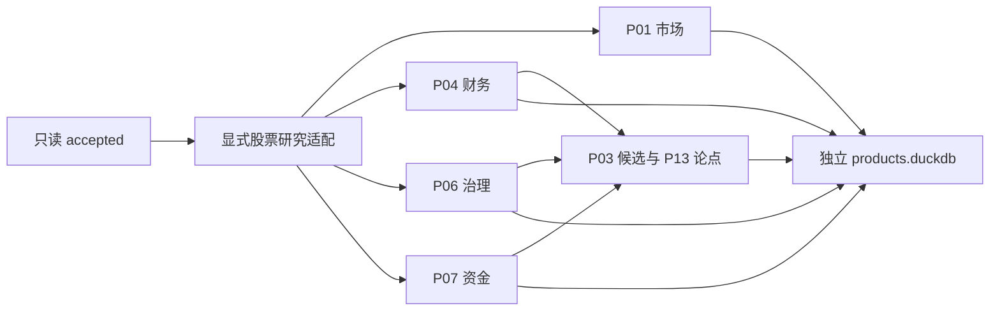

# 股票研究闭环

本阶段实现 P01、P03、P04、P06、P07、P13。入口从只读参考库加工数据，结果写入独立产品库。当前模式为 `observed_research`，所有结果都保留 `historical_pit_certified=false`，不生成历史回测、收益预测或自动交易指令。

## 引擎与共享适配分开

`equity_research` 包内，`adapter.py` 检查参考契约、实体、时点和单位，`models.py` 定义输入与结果，`common.py` 复用证据去重、同行分位和公共信封。六个引擎分别放在 `market.py`、`fundamental.py`、`governance.py`、`flow.py`、`candidates.py`、`events.py`。`pipeline.py` 展开依赖并控制事务，CLI 只处理参数、进度和退出码。



原有 `product_foundation` 和 206 接口消费登记保持兼容。新的 `research` schema 保存业务结果，原有 `product` schema 仍供基础层使用。六产品分配的 99 个唯一接口全部绑定到实际执行器：`consumption_registry.py` 校验分配与处理器一致，适配器据此扫描，`consumption.py` 保存逐接口结果并核对引用。`context_consumers.py`、`disclosure_consumers.py` 和 `flow_consumers.py` 分别处理市场与技术旁证、财务治理证据、局部资金与资格背景。

| 产品 | 分配接口数 | 本轮补齐的消费 |
| --- | ---: | --- |
| P01 | 19 | 指数身份与当前状态、指数周月核对、市场汇总对账、LPR、经济日程、账户、市场资金、交易日历 |
| P03 | 16 | 北交所代码映射、复权锚点、日周月与组合行情核对、因子字典、供应商技术旁证 |
| P04 | 10 | 备用估值股本快照、普通与 VIP 财务指标同口径核对 |
| P06 | 25 | 新股、治理事件、持有人、转债行情与发行、评级、票息区间证据 |
| P07 | 24 | 筹码成本核对、游资字典与局部席位、陆股通前十、连板、融资资格、转融券及龙虎榜背景 |
| P13 | 5 | 延续新闻、宏观与披露日程、指数公告、名称变更，并接收上游产品证据 |

99/99 表示每个分配接口都有会被执行的真实消费路径；当前数据是否可用另按接口状态披露。缺绑定时对应来源不会扫描，结果保留 `unknown`，不能把执行过降级逻辑称为读到了数据。

上下文分组汇总先保留冲突，再保留未知和历史受限状态。只有各组都可判定且至少一组已观测时，接口才记为 `observed`；已观测组与明确不适用组可以并存，未知组不能被覆盖。

## 六个产品的计算边界

| 产品 | 已实现加工 | 拒绝或降级条件 |
| --- | --- | --- |
| P01 `market_context/v1` | 同交易日有效股票广度、合格分母、无成交及停牌等排除数、前 10% 股票成交集中度、跌停占比、三项等权压力分。连接停复牌记录。PMI、PPI、M1/M2 差、社融、CPI 和季度 GDP 保留报告期与可用时间，检查相邻期后才给变化 | 无有效成交价不计广度；跌停边界不齐时不发布压力分；宏观缺相邻期只给当前值，不把月值当每日新信息 |
| P04 `fundamental_dossier/v1` | 按实体、报告期、报表类型、公司类型选择已可见版本。计算 `cash_margin`、`leverage`、`cash_cover`、`balance_error` 和 `quality_score`／`Q0`。核查审计，保留负权益、负利润证据 | 三表口径、单位、版本、行业或审计不合格时不发布合格质量评分；VIP 与普通接口一致时只计一份经济证据；同可用时点冲突不任选版本 |
| P06 `capital_governance_risks/v1` | 公告、计划、实施、终止分开；认证后计算未来 30 自然日解禁、计划和实施定增稀释、CB 全部转股上界、质押与供给压力。ST、重点监控和重大状态冲突独立门禁 | 未确认批次不相加；未知与无适用事件分开；缺少 CB 身份、正股关系、期间、币种或单位时不算稀释；EB 不按 CB 处理 |
| P07 `flow_feasibility/v1` | 各资金来源独立除以同日合格成交额，计算中位数、方向、一致性、资金支持；融资强度、换手和合格筹码分布形成独立拥挤轴。保留大宗折价证据 | 停牌、无价格、涨跌停、严重异动、量额矛盾、过期分别检查；少于两个可比资金来源时一致性未知；匿名席位和局部分钟数据不外推 |
| P03 `equity_research_candidates/v1` | 消费 P04/P06/P07，计算价值 V0、流动性 L0、完整 C0 或市场档分数，隔离财务类型、profile 与同行回退层后排名。输出贡献、反证、排除理由、下一问题和删一因子排名区间 | 负 PE、负 PB 或认证负权益／亏损进入问题研究档；分数不能抵消硬门禁；样本不够不排名；缺财务只能进独立市场档 |
| P13 `event_thesis_review/v1` | 整理新闻、披露日程、宏观日程、指数公告、名称变更和上游结果。保存原文片段、实体候选、人工关系、三值论点与确定性复核顺序 | `documented_reason` 必须引用原文原因句；`temporal_association` 只表示已核对的同窗观察。无代码文本和歧义实体等待确认；持仓权重未知不补造；历史不足不算 CAR |

同行分位使用平均秩，默认至少 30 个同口径合格样本；相同值取 0.5。`peer_paths` 从大类到细类给出认证后的同行路径，允许逐级回退。不同财务口径与实际回退层不会混排。

停牌来源无记录时，必须有完整范围认证且没有来源拒绝原因，才能认定未停牌；隔离、未来公开或其他来源缺口保留未知并排除出市场分母。严重异动门禁要求合格质量、已可见和已生效，结束时点采用半开区间；被拒记录或缺口不能转换成明确放行或阻断。审计门禁只匹配当前财报的精确报告期，较早意见保存在 `details.historical_audits`，不能放行当前财报。

核心公式保持设计原义：`Q0=100×[0.4p(cash_margin)+0.35(1-p(leverage))+0.25p(cash_cover)]`，`V0=mean[p(1/pe_ttm),p(1/pb)]`，`L0=p(log(1+amount_cny))`，`C0=0.45Q0+35V0+20L0`。市场档为 `100×(0.6V0+0.4L0)`。公式档另存于 `details.score_profile`，`feature_profile` 追加公司类型等可比边界。

## 显式绑定决定可计算范围

`--config` 接受 `ResearchConfig` 的 JSON 序列化结果。`foundation` 内沿用 `FoundationBindings` 的实体、别名、时间映射和单位证书；不会从代码形状或中文名称推断实体与币种。无绑定时先审计接口就绪条件，不逐行扫描。

行内实际存在的 `ann_date`、`f_ann_date`、`pub_date`、`publish_date`、`pub_time`、`res_ann_date` 等公开字段必须纳入公开时间映射。日期级公开时间采用显式市场时区的次日零点，无法认证时拒绝该行。日频行情和财务业务日期不能晚于研究截止日；已公告的未来事件另按计划阶段处理。

| 配置项 | 含义 |
| --- | --- |
| `version` | 固定 `equity-research/v1`，规则改变必须升级版本 |
| `foundation` | 已认证实体、有效期别名、字段时间、单位、预期业务日期 |
| `thresholds` | 基础层版本化阈值，默认同行样本 30、批大小 512、观察年龄上限 7 日 |
| `peer_paths` | 每个股票实体的可比组路径；没有认证路径时不生成分位 |
| `certified_report_types` | 允许计算的已认证报表类型；空列表不擅自认定合并范围 |
| `complete_scopes` | 明确已完整核查的 API 请求范围；缺表、契约失败、局部容量拒绝仍优先保留未知 |
| `confirmed_relations` | 带证据与有效期的人工关系；CB 使用 `cb_underlying`，事件实体使用 `event_entity` |
| `binding_audit_json` | 生成规则、reference SHA256、截止时点、配置及审计摘要、逐接口缺口；运行前重新核验 |
| `maximum_rows_per_entity_source` | 每来源每实体最多保留 512 行，跨报表口径累计；溢出整实体来源拒绝 |
| `maximum_source_rows`／`maximum_total_rows` | 默认 32768／131072 行，限制观察集内存；溢出来源不参与精确总量和评分 |

人民币金额使用认证后的“元”，股票数量使用“股”，比例按字段契约使用 `ratio` 或 `fraction`。`fraction` 指标限定在 0 到 1，解禁、稀释等可能超过 1 的比值使用 `ratio` 保留原值。已由参考层换算的金额不再乘一次单位因子。价格证书区分当日成交价与转股价、涨跌停边界、筹码报价，后者不会被当成真实成交。

参考库实际读取缓冲最多 128 行，调用方批大小限定在 1 到 512。研究存储和来源回查的直接入口也使用这一硬上限，非法批大小在访问数据库或消费生成器之前拒绝。写入另按编码后 JSON 的 512KiB 预算和最多 128 行拆批，单条超预算记录独占一批、不截断；较大的 `result` 载荷逐条写入。参数列替代整批 JSON 的反复展开，写入连接关闭插入顺序保留，确定性由主键和规范排序保证。

普通日频保留当前业务日，财务按口径保留当前报告期，宏观保留最近两个报告期；评级按机构、周月按频率、因子按名称分别保留，事件受容量门禁限制。DuckDB 使用 1 个线程和 512MB 内存限额。扫描账本区分 `retained_rows`、`excluded_rows`、`discarded_rows`，三者之和等于 `scanned_rows`；历史释放和容量拒绝归入 `discarded_rows`。

## 从正式参考库生成绑定

`research build-config` 只读取指定的 reference DuckDB，不联网、不读取 token，也不搜索本机缓存。生成器由 `binding_builder.py` 编排，`binding_entities.py`、`binding_rules.py`、`binding_units.py` 和 `binding_io.py` 分别负责身份、时间注册、单位证据及容量与文件边界。配置可以直接交给现有 `research run --config` 使用。未传配置的旧入口继续零扫描降级。

生成规则版本为 `research-bindings/v1`。配置绑定参考文件 SHA256、标准层政策与契约指纹、99 项时间注册、生成截止时点、配置内容摘要及独立审计摘要。构建前后和发布前都校验参考文件，存在未合并 WAL 的库拒绝生成。来源、截止时点或配置变化后须重新生成；运行命令在创建产品库前检查这些约束。

| 绑定 | 生成依据与限制 |
| --- | --- |
| A 股实体 | 仅使用已验收的 `accepted.stock_basic`。代码需符合 A 股格式，上市状态与上市、退市日期必须一致；重复代码整组拒绝。别名保留上市至退市的左闭右开有效期和来源引用 |
| BSE 旧新代码 | 旧新代码对中恰有一端出现在股票主数据中，且该端身份已确认、名称与上市日一致、一对一无冲突时才加别名。缺少换码生效日，别名仅从观察时点起有效。两端已有不同身份时报告冲突，不按名称合并 |
| 指数与转债 | 分别使用 `tushare_index/index` 与 `tushare_cb/convertible_bond` 身份，股票为 `tushare_stock/security`。代码相同不跨类型合并；仅 `cb_basic.stk_code` 指向唯一股票且生命周期有交集时生成 `cb_underlying`。EB 不生成该关系 |
| 时间 | 99 个接口逐项登记业务期间、公开字段、报告期间及生效区间。财务 `end_date` 只表示报告期，宏观保留月或季粒度且只接受已结束期间，周月行情使用实际统计终点。日粒度按市场本地日期判断，月、季、年按真实期间终点判断，避免季度字符串及 UTC 跨日误判。可空公开字段中所有非空值取最晚边界，再与观察时间取较晚值；实际出现未注册公开字段则整个构建失败 |
| 单位 | 复用标准层转换表，并检查完整扫描范围内的单位声明一致性。已有标准值只做单位语义适配，不重复缩放。金额币种必须由本行或已确认股票主数据证明；单位、币种或跨行声明冲突都不发证。文档明确“未说明”的字段始终保留缺口。政策已经执行非恒等转换而标准单位元数据缺失时，记录 `unit_standard_missing`，不假定当前值仍是源单位 |
| 同行路径 | `stock_basic.industry` 的当前观察值经稳定哈希形成同行路径。它不证明历史行业成员资格。缺行业保留股票身份、不给同行路径，记录 `industry_unclassified` |
| 预期业务期间 | 只对当前可读观察范围内、业务期间可确定的非事件来源生成 `expected_data_as_of`。快照和缺业务日期来源不以观察时间补交易日或报告期 |
| 财报口径与完整范围 | 当前文档快照没有足够的报表类型解释及跨来源范围证据，`certified_report_types` 和 `complete_scopes` 保持空，分别报告未认证。不为生成 Q0 放宽门禁 |

单位构建只扫描六产品消费注册中的数值字段。每张单位证书引用实际 `accepted` 记录和字段；使用股票主数据证明币种时额外保留 `curr_type` 引用。配置与审计只保存绑定、标识、计数和字段引用，不保存新闻正文、原始大字段或凭据。

默认每批最多读取 128 行，单行绑定投影上限 64 KiB，单接口最多扫描 200 万行，全库最多 500 万行，主数据最多 5 万条。DuckDB 使用单线程和 512 MB 内存。API 支持 `BuildLimits`，CLI 可以显式调整批大小、单源行数、总行数和主数据上限。主数据采用有限集合，其余来源逐批累计证书与缺口；别名按命名空间和代码建立索引，运行时保留完整生命周期冲突检查。

生成完成退出 0，即使审计存在缺口也会保存可使用的配置。硬失败退出 1，stdout 的 `reason_codes` 为 `research_build_config_failed`，`detail_code` 给出固定细分原因。常见原因包括 `input_output_path_collision`、`reference_catalog_missing`、`binding_stock_basic_missing`、`binding_scan_capacity_exceeded`、`binding_entity_capacity_exceeded`、`binding_row_capacity_exceeded`、`binding_reference_wal_present`、`public_field_mapping_missing` 和 `reference_changed_during_read`。未知底层异常只返回 `binding_io_failed`。

缺表、缺字段、重复或冲突实体、未来公开时间和无法认证单位按来源进入审计的 `sources`。目录查询仅限六产品注册的 99 个来源，不以整个 catalog 的行数限制构建，额外派生日历或目录项可以存在。这 99 个必需 manifest 缺失、重复或契约不符时，分别以 `reference_manifest_missing`、`reference_catalog_duplicate`、`source_contract_mismatch` 失败。缺 catalog 或 stock_basic 主表也直接失败；其他 accepted 表或数据缺失仍允许降级。输出先写临时文件，再依次原子替换审计和配置，配置是最后的提交标记。

构建摘要的 `observed_apis` 固定为 0，因为构建阶段没有执行研究消费者。运行摘要的 `bindings` 区分 `configured_apis`、`readable_apis`、真实 `observed_apis` 和 `unresolved_apis`，同时给出 `unresolved_reasons`。已观察接口仍可能存在单位缺口，后两个集合可以重叠。真实可用性验收必须同时检查 `processing.scanned_rows > 0` 与 `consumption.observed_apis > 0`；不要求缺行或证据不足的 99 个接口全部达到 observed。

## 命令行与幂等运行

以下命令按生成配置、运行、校验的顺序离线执行。路径是示例，需指向同一份已完成写入的参考库；配置、审计和产品库不得覆盖参考库，也不应提交到代码仓库。`initialize` 与 `run` 走同一条原子路径，第一次创建产品表，之后按输入指纹决定复用或写入新批次。

```bash
uv run tushare-hub research build-config \
  --reference /path/to/reference.duckdb \
  --output /path/to/research-config.json \
  --audit /path/to/research-bindings-audit.json \
  --as-of 2026-10-03T12:00:00Z

uv run tushare-hub research run \
  --reference /path/to/reference.duckdb \
  --output /path/to/products.duckdb \
  --as-of 2026-10-03T12:00:00Z \
  --config /path/to/research-config.json

uv run tushare-hub research validate \
  --reference /path/to/reference.duckdb \
  --output /path/to/products.duckdb
```

需要缩小运行范围时可附加 `--product P03 --product P13`，它会自动运行 P04/P06/P07 依赖。进度逐行输出到 stderr，stdout 只输出一个 JSON 摘要。运行成功且全部可用退出 0，存在诚实降级退出 2，参数或执行失败退出 1；校验成功退出 0、失败退出 1。

运行键绑定参考文件 SHA256、截止时点、完整配置、请求产品集合和规则版本，并加入 `equity-consumption/v9` 及消费注册指纹。旧消费版本的结果不能作为本次范围隔离后的结果复用。相同输入重跑先验证已有结果，再返回相同摘要，不增加记录。不同运行保留各自结果，`research.metadata.current_run` 指向当前批次。信封 `generated_at` 使用确定性的逻辑生成时点，即 `analysis_as_of`；该字段不能作为历史运行发生时间或历史 PIT 认证的证据。

别名、单位证书和人工关系中的 `reference:accepted` 引用与普通证据一样，回查来源行、字段、契约、隔离状态和时点。`assertion:` 与 `synthetic:` 是独立配置断言类型，要求内容与当前配置完全一致且在截止时点可见；它们不代表参考库已经认证该断言。

旧 48 接口产物缺少新消费账本，不能通过本版本的 99 接口完整性校验。升级验收应从只读参考库输出到新的产品库路径，并保留旧库；不会自动为旧结果补造消费证据。

## 输出表与完整校验

每张数据表都有 `record_id` 主键、`run_id`、`result_id` 和 JSON `payload`，便于独立 SQL 查询。输出采用有限数值，缺失保留空值与原因码。

上下文消费者超过 64 条输入时采用 `context-aggregate-v2`，所有保留行仍参与处理。`total_rows`、`usable_rows`、`rejected_rows` 分别记录输入、通过质量及时点门禁、被拒绝的行数；`group_count` 和 `status_counts` 对最新版本组计数，`rows_by_group_status` 记录这些组覆盖的行数。`field_coverage` 只统计合格行的字段存在性和认证覆盖。全部输入行的身份、关键字段、价格与单位语义、时间、质量和证书进入 `rows_fingerprint`，全部组的业务事实与状态进入 `groups_fingerprint`，全部本源及对照引用进入 `evidence_fingerprint`，再与规则版本、来源、截止时点共同生成 `full_fingerprint`。行和组的指纹使用带计数、模2^256的和及平方和的流式多重集摘要，不保存或排序全量叶哈希；重复行仍影响摘要，输入顺序不影响结果。引用按完整规范JSON在私有临时SQLite中精确去重，本源字段查询和分类基数同样使用临时集合，页缓存限制为2 MiB并允许溢写。Python中只保留固定大小摘要、最多40个证据样本及每维最多16个分类计数；正常或异常退出都关闭并删除临时库，不访问正式缓存。

`index_basic` 汇总 `market`、`publisher`、`index_type`、`weight_rule` 的最新组可用性和分类分布。每个维度最多展示按字典序排列的 16 个值，其余组数列入 `other_groups`；超过 128 个 UTF8 字节的值只计入 `oversized_value_groups`，完整内容仍进入指纹。`idx_factor_pro` 汇总认证字段覆盖、同日量价核对的 matched／conflict／unknown 计数；供应商因子仍不构成独立经济证据或买卖信号。

证据按组状态及本源／支持证据分层，每层选择 SHA256 最小的 4 个引用，最多 40 个。本源必须指向本次保留行中实际存在的消费字段；对照来源及范围外的单位证书见证行归入支持证据，避免挤掉当前本源引用。`sampling_policy`、`candidate_reference_count`、`sample_count` 和 `truncated` 明确披露抽样；统计与指纹不抽样。每个引用最多 4096 个 UTF8 字节，超过时明确失败，不截断定位信息。超过阈值的聚合只产生一个软门禁，消费封装另加一个执行状态门禁；未知和冲突仍保留原因，聚合门禁保留各组原因码的并集。64条以内保留逐组观察，多组门禁按组键增加确定性摘要，避免同一API的门禁主键冲突。

存储继续使用 512MB DuckDB 限额，并在单条 `research.result` 的完整 JSON 超过 8 MiB UTF8 字节时，于执行该条 SQL 前抛出 `research_result_payload_capacity_exceeded`。CLI 同样返回此固定原因码和退出码 1。该限制不截断结果，外层事务会回滚已写入的本轮记录。

| 表 | 保存内容 |
| --- | --- |
| `research.result` | 公共 DecisionEnvelope、业务指标、扩展解释、上游结果键和三值论点 |
| `research.feature` | 原值、单位、available／unknown／not_applicable、原因和证据 |
| `research.contribution` | 每项权重、归一值、分组与评分贡献 |
| `research.evidence` | 来源接口、记录／业务组／变体身份、契约摘要、字段定位及观察时间 |
| `research.gate` | true／false／unknown 门禁、硬门禁标志和原因 |
| `research.signal` | 论点谓词的确定性三值结果 |
| `research.lineage` | used／contrary 来源关系和 parent 产品依赖 |
| `research.run` | 输入指纹、配置、规则版本、产品依赖闭包与运行摘要 |
| `research.metadata` | 当前批次定位 |

```sql
SELECT payload->'envelope'->>'product_id' AS product,
       payload->'envelope'->>'entity_id' AS entity,
       payload->'envelope'->>'state' AS state,
       payload->'envelope'->>'score' AS score
FROM research.result;

SELECT payload->>'name' AS feature,
       payload->>'value' AS value,
       payload->>'status' AS status
FROM research.feature;
```

校验会重建模型和全部派生表，对账主键、结果与父引用、数值范围、三值状态、贡献、产品依赖、运行摘要和规则指纹。当前批次的证据还会回查只读 `accepted` 行；配置中明确提供的别名、单位和人工关系证据则与配置逐字核对。历史批次保留原参考指纹并检查内部完整性，当前参考文件不冒充旧批次原始文件。

每条结果的 `details.consumption` 按所属产品保存精确接口清单，包含矩阵角色与用途、处理器、保留策略、已读行数、字段质量、业务事实、证据和三值门禁。消费引用进入 `research.evidence` 与 `research.lineage`，门禁进入 `research.gate`；新增旁证不改变原核心分值或贡献。未关联转债和全局字典由独立 `source_observation` 结果承接，不能混入股票排名。

运行摘要的 `consumption` 分别统计 `assigned_apis`、`registered_apis`、`executed_apis`、`observed_apis`，并用 `by_api` 保存状态分解。`observed` 表示有合格行和引用的当前观察；`conflict` 表示同口径核对发现分歧；`unknown` 表示缺字段、单位、关系或绑定；`not_applicable` 表示确认不适用；`not_enabled_due_to_history` 表示已经读到数据并保存引用，但相应历史计算条件不足。完整校验会重验这些记录，拒绝用空行、无引用或 `1/0` 冒充有效状态。

## 降级后的结果仍能追查

`annotated` 表示可供当前观察研究，但历史 PIT 未认证。`incomplete` 表示必需数据、口径或门禁未知；`blocked` 表示硬门禁明确失败。`unknown` 不等于 `false`，也不等于无风险。只有已核查完整范围且确无相关事件时，指标才可标为 `not_applicable`；不适用也不会作为数值 0 混入供给评分。

所有产品只读取 `accepted`。`fut_daily`、`fut_weekly_monthly`、`idx_factor_pro`、`opt_daily` 的隔离数据不会进入本阶段股票评分。日线 0 价或无成交占位也不能用于收益、广度或可行性。未来观察和未来公开信息会在适配时拒绝，已公告的未来事件只作为计划保留。

## 与设计附件的适配差异

金额与比例认证仍以仓库当前契约为准。财务总权益使用真实字段 `total_hldr_eqy_inc_min_int`，不会拿归母权益补齐平衡式；`report_type`、版本和三表金额没有默认认证。东方财富和同花顺资金都使用真实 `net_amount`，分别归一，未把不同来源金额相加。季度 GDP 使用 `quarter` 和 `gdp_yoy`，CPI 使用 `month` 和 `nt_yoy`。

产品结果以每证券当前观察记录为主，P06 的事件组和阶段保存在扩展明细内，P13 使用事件 scope 区分多条结果。同证券的 P04/P06/P07 合为一条 `upstream_bundle`，五类真实来源事件仍逐事件输出。文本实体关系必须由显式证据确认；新闻和指数公告没有证券代码时不会补造代码。默认论点使用版本化的“现金覆盖至少 1 且未来解禁低于 5%”，它是待校准的研究条件；未提供的持仓权重保持未知。

交易日历已进入当前观察链；缺少经过认证的完整未来日历时，交易日距离仍未知，供给窗口使用 30 自然日。周月来源已经读取并核对统计终点、频率及当前收盘，完整期间的量额重建还需要全部日线。供应商因子和复权报价保留原来源与单位状态，缺公式、回看窗口或固定锚点证据时不转成本地历史特征，也不增加独立经济证据数。

`fina_indicator` 与 VIP 快照没有 `report_type`／`comp_type` 时，记录 `indicator_report_scope_schema_gap`，不会借三表口径替该接口补认证。`ocf_to_profit` 按经营现金流／营业利润核对，不能误用净利润。P07 使用当前真实字段 `slb_sec.lent_qnt/end_bal`、`slb_sec_detail.tenor/fee_rate/lent_qnt` 和 `limit_list_ths.limit_type/open_num/lu_desc`；陆股通北向资格识别 `HK_SH/HK_SZ`，南向类型不归因于 A 股资金流。

## 尚未启用的能力

尚未实现 P02 行业主题、P05 预期差、P08 ETF 穿透、P09 商品链、P10 海外可比、P11 融资尾部压力、P12 组合调整。当前股票闭环也未启用财务 TTM、12－1 动量、60 日波动、滚动资金持续性、历史版本认证、事件 CAR、策略回测和交易容量预测。

没有足够历史时，单日和单期输出只描述已观察证据，不能据此推导长期盈利质量、策略有效性、择时胜率或因果结论。

## 离线复现

仓库只提交确定性生成器，数据库和配置产物写入临时目录。生成器不会请求真实 Tushare，也不读取凭据。

```bash
uv run python tests/research_fixture.py --output-dir /tmp/equity-research-demo
uv run tushare-hub research run \
  --reference /tmp/equity-research-demo/reference.duckdb \
  --output /tmp/equity-research-demo/products.duckdb \
  --config /tmp/equity-research-demo/research-config.json \
  --as-of 2026-10-03T12:00:00Z
uv run tushare-hub research validate \
  --reference /tmp/equity-research-demo/reference.duckdb \
  --output /tmp/equity-research-demo/products.duckdb
```

重复执行同一 `run` 命令应返回相同摘要和记录数。缺少某些事件、审计或筹码证据时允许退出 2，校验仍应返回 `valid=true`。自动化测试另外覆盖公式正确值、失败门禁、变体冲突、512 行边界、幂等和存储篡改。

99 接口消费验收使用 `uv run python tests/consumption_fixture.py --output-dir /tmp/consumption-demo` 生成全部来源，再将上述 CLI 路径替换为该目录。该夹具只使用当前文档快照中存在的字段，并加入一条指数因子隔离毒值。对应测试按 99 个接口逐项检查已读取行、所属产品、角色、字段质量及持久化本来源引用，同时验证缺绑定时全部保留未知。


绑定生成的合成验收由 `tests/test_research_binding_acceptance.py` 执行。夹具用正式 `normalize_reference_row` 和 `reference_columns` 创建两只股票及三个行情来源，覆盖 `build-config → run → validate`，同时断言真实扫描、observed 接口、参考文件只读、配置与审计字节一致、重跑数据库逻辑快照一致、输入变更拒绝。它不读取正式参考缓存；正式约 145 万行的数据验收由本地 Agent 在提交后执行。

### P01 全市场证据容量

P01 的指标仍使用全部合格日线与同日跌停边界，停复牌和排除计数也使用全部参与行。
`market_evidence_audit` 按合格日线、排除日线、已用跌停边界、停复牌、停复牌反证和六类宏观来源分别记账，
输出 `total_rows`、`candidate_reference_count`（去重前引用出现次数）、`status_counts` 和 `full_fingerprint`。
另外对所有保留的 daily、stk_limit、suspend_d 输入做只含指纹的审计，包括未被最新版本选择和被时间门禁排除的行。
指纹复用 `sha256-multiset-sum-squares-v1`，涵盖全部参与行的来源身份、关键字段、时间、质量、数值证书与角色状态；
重复行逐次计入，输入顺序不影响结果，不保留全量 Python 哈希集合。

每个展示角色总计最多选 8 行：先按状态保留各状态的最小行 SHA256，再按全局行 SHA256 补齐剩余名额。
只有具备候选引用的行可参与展示；样本保留状态、原始来源身份和定位字段，`sampled_status_counts` 披露展示状态分布。
`sampling_policy`、`sample_count`、`sample_reference_count`、`truncated` 明确披露展示边界；
`*_input` 角色只计算全量指纹，不展示引用。指标与贡献共享这批代表证据，信封合并去重，
全量来源业务日期单独累计，不从样本推断最新日期。
日线最多 40 个字段引用，跌停边界最多 16 个，停复牌最多 24 个；反证最多 48 个。
六类宏观来源各最多 8 行（按注册字段理论上限各 72 个引用）；基础信封总上限 512 个引用。
停复牌明细由 `suspension_all` 保留全部状态的审计与最多 8 条代表记录。
`suspension_used` 仅承接明确复牌，停牌与未知记录只进入 `suspension_contrary`，正反血缘互斥。
单引用和单条展示的停复牌明细均有 4096 字节上限，超限分别报
`research_market_evidence_capacity_exceeded` 和 `research_market_observation_capacity_exceeded`，不截断定位信息。

宏观当前期和相邻期的全部候选版本均进入指纹，包括歧义版本及被取代的旧版本；只有唯一选中的版本参与数值计算。
P01 宏观消费当期超过 8 行即限制为 8 行代表值，
用 `certified_values_scope=evidence_sample_only` 标明认证值列表是样本，
`current_record_count` 和 `certified_field_counts` 仍统计全部当期行。
抽样规则为 `market-evidence/v2`，可展示状态数超过 8 时以 `research_market_sample_status_capacity_exceeded` 失败。
运行版本已更新为 `equity-consumption/v7`，避免复用旧的证据角色和抽样结果。

## P13 上游按实体审阅

`equity-consumption/v8` 将上游事件从“每个父结果一条”改为“每实体一个 bundle”。例如
6000 个证券各有 P04/P06/P07 三份父结果，只生成 6000 条上游审阅；32 个证券的旧版
96 条上游审阅变为 32 条。空参考库的六产品降级结果由 8 条变为 6 条。`major_news`、
`disclosure_date`（含计划、实际、修正）、`cn_schedule`、`idx_anns`、`namechange`
仍保留各自事件，不与 bundle 合并。

父结果以稳定 `result_id` 一次去重。唯一父结果不调用 `to_json`；只有同 ID 的不同对象
才比较完整规范 JSON，相同内容幂等，冲突报 `research_event_parent_conflict`。随后建立
实体索引，每次审阅只读取该实体的父版本，父处理成本随输入及其内容大小线性增长；
父版本和最终复核队列另作确定性排序，不再进行全体父结果的两两比较。
共用的股票实体集也按 `ResearchInputs` 快照缓存，避免每生成一条结果就遍历并排序
全部证券。来源行或配置变化时用 `dataclasses.replace` 创建新快照，实体集与既有
来源行索引一起重新计算，证券、债券、指数和非证券序列的过滤规则保持不变。

事件 ID 绑定实体及排序后的全部父 ID；`parent_result_ids` 保存完整血缘。
`upstream_parent_count` 记录有效父数，`upstream_fingerprint` 绑定每个父结果的全部
声明字段，包含未用于论点的明细。指纹逐块计算，不缓存完整父 JSON，不抽样父结果。
论点所需指标、全部父引用、硬门禁与反证继续进入结果。同产品多版本不任选一个：
`upstream_ambiguous_products` 列出歧义产品，对应指标保持未知，并增加
`upstream_product_versions_ambiguous` 硬门禁。每实体最多 64 个当前唯一父版本，
第 65 个报 `research_event_parent_capacity_exceeded`；重复版本不占额外容量。
单结果仍受存储层 8 MiB 上限约束，超限明确失败，不截断证据。

错截止父结果不进入实体索引。缺实体父结果报 `research_event_parent_entity_missing`；
市场父结果单独形成市场 bundle，带 `upstream_market_scope_not_security`，不取得证券
确认资格。无实体或歧义的真实事件不继承任何候选证券或市场父结果。

回归包含父 ID 冲突、顺序与重复幂等、全量摘要、版本与截止边界，以及 6000 实体 × 3
父结果的真实 `build_events`、`attach_consumption` 和 512MB DuckDB 保存／重建。
性能断言使用父遍历、实体查询及完整序列化调用次数，不使用绝对耗时阈值。

## 市场结果按消费范围选行

`equity-consumption/v9` 按注册的 `entity_scope` 分流，避免用于承接未绑定来源的市场结果
重复消费所有股票行。`MARKET_ENTITY` 遇到 `stock` 范围始终返回空，并记录
`stock_scope_requires_entity`；`market` 范围仍读取全来源，`bond`、`dictionary`、`event`
范围在市场结果中仍保留全部行。普通股票实体的转债关系、字典匹配和实体索引逻辑不变，
消费处理器仍实际执行，99 接口注册不变。

stock 行继续由对应实体结果消费，市场记录的 `retained_row_count` 为 0。验证器拒绝
市场结果声称消费了非零 stock 行。未映射的 stock 行保留在只读参考库，适配层将其计入
`excluded_rows`，同时记录 `stock_entity_unresolved`。若保留输入中仍有无实体行、误绑
市场的 stock 行，或没有对应实体结果，`stock_scope_gaps` 只记录每来源的
`unmapped_retained_rows`、`unrepresented_retained_rows` 和 `adapter_entity_rejections`。
这些缺口进入带 `stock_rows_without_entity_result` 的未知市场诊断，已有阻断不被升级，
不复制原始行、不生成错误实体归属，也不把缺口算作已观测。

单结果 8 MiB 上限不变。超限在该结果的 SQL 写入前抛出 `ResultPayloadCapacityError`；
内部调用方可读取 `product_id`、`entity_id`、`payload_bytes` 定位问题，诊断属性不保存原始
载荷。异常字符串和 CLI 输出仍只有 `research_result_payload_capacity_exceeded`，不公开
载荷或诊断属性。

范围回归使用 150 个实体、每实体 487 条解禁记录，共 73050 行，核对逐股消费计数守恒、
市场 stock 消费为 0、未绑定转债仍可见，以及 512MB DuckDB 保存和重建。另覆盖 P03 字典、
P13 事件、P01 市场来源、未映射行缺口及真实超限结果的安全诊断。
单结果 8 MiB 门禁与 DuckDB 512MB 内存限制保持不变。
